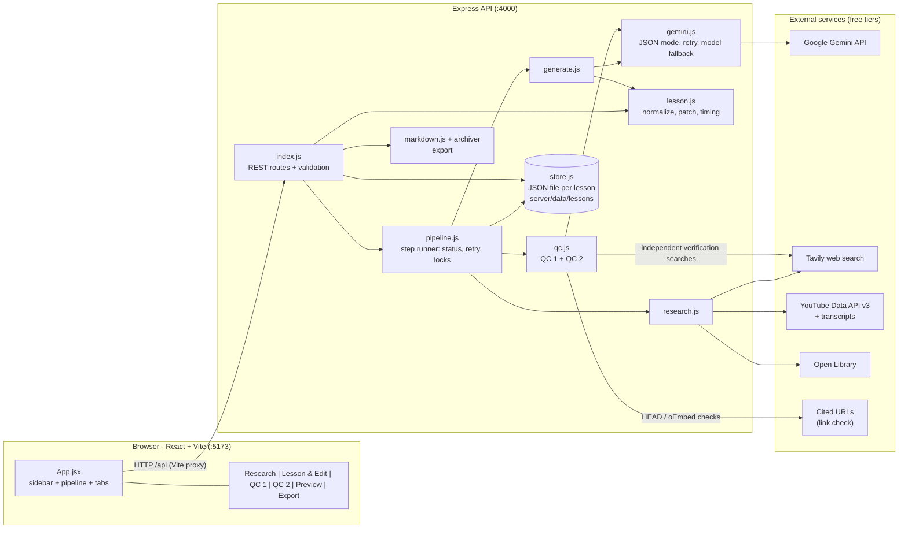
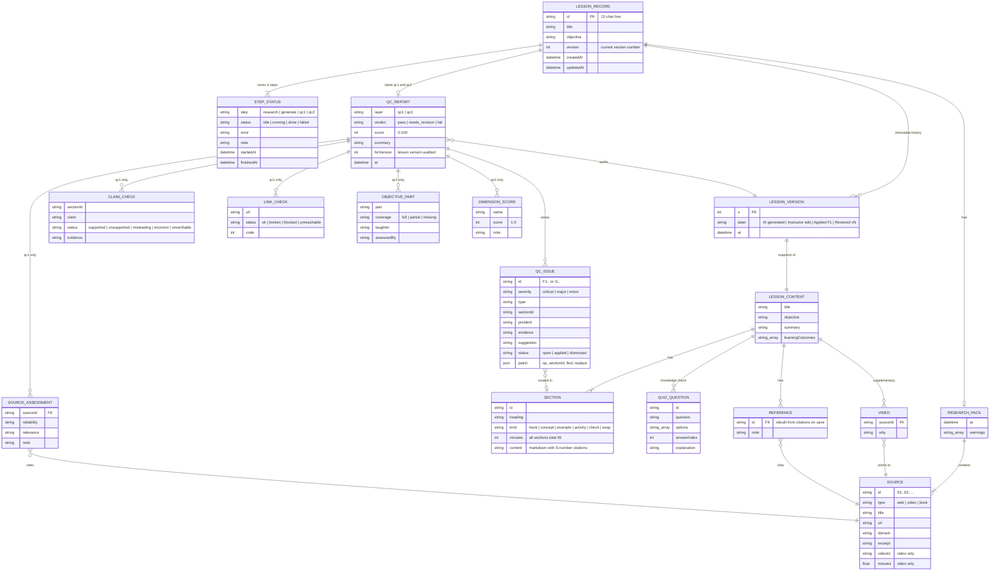

# LessonForge

AI-powered lesson creation tool. Give it a **Lesson Title** and a **Learning Objective**; it researches websites, YouTube and books, writes a structured **45-minute** lesson with citations, then audits it with **two independent QC layers**. Instructors can review, edit, apply QC fixes, preview and export.

Built for the Kalvium AI Research Intern task.

## Quick start

Requirements: Node.js 20+ (developed on Node 24).

```bash
npm run install:all          # installs root, server and client deps
cp server/.env.example server/.env   # then fill in the three API keys (all have free tiers)
npm run dev                  # API on :4000, UI on http://localhost:5173
npm test                     # unit tests for the deterministic logic
```

### API keys (all free tier)

| Key | Where to get it | Used for |
|---|---|---|
| `GEMINI_API_KEY` | https://aistudio.google.com/apikey | Lesson generation + both QC layers |
| `TAVILY_API_KEY` | https://tavily.com | Web search / page content (research + QC 1 independent verification) |
| `YOUTUBE_API_KEY` | Google Cloud Console → enable *YouTube Data API v3* → create key | Video search and metadata |

`GEMINI_MODELS` is a comma-separated fallback chain (default `gemini-3.5-flash,gemini-3.5-flash-lite`). Google retires free-tier model names over time; if you see a 404 "no longer available", change it to a current model. Never commit `server/.env` (it is git-ignored).

## How it works

```
Title + Objective
  1. Research  → Tavily web search, YouTube Data API (+ transcripts), Open Library  → "source pack"
  2. Generate  → Gemini writes JSON lesson, citing [S#] ids from the pack only
  3. QC 1      → factual / research audit  → report 1
  4. QC 2      → instructional-quality audit → report 2
  5. Review    → edit, accept/dismiss each QC recommendation, version history, preview
  6. Export    → ZIP: lesson.md, references.md, both QC reports, lesson-data.json
```

Each step is its own endpoint with status `idle | running | done | failed` and can be **retried independently**.

## Deploy on a free tier (Render)

The repo includes a [`render.yaml`](render.yaml) blueprint: **one free web service** that serves both the API and the built React UI (no CORS, one URL).

1. Push this repo to GitHub (make sure `server/.env` is **not** committed - it is git-ignored).
2. On https://render.com (no credit card needed for the free plan): **New → Blueprint** → pick this repo → *Apply*. (Or **New → Web Service** and enter: build `npm run build`, start `npm start`, health check `/api/health`.)
3. When prompted, set the secret environment variables: `GEMINI_API_KEY`, `TAVILY_API_KEY`, `YOUTUBE_API_KEY` and **`APP_PASSWORD`**.
   - `APP_PASSWORD` turns on HTTP Basic auth for the whole app (any username, this password), so strangers cannot burn your free API quotas. **Set it on any public deployment.**
4. Wait for the build, open the service URL, enter the password, and check `https://<your-service>.onrender.com/api/health` shows all three keys `true`.
5. Run the sample lesson end to end to confirm.

**Free-tier caveats** (design accordingly, and mention them in a demo):
- **No persistent disk.** Lessons live in `server/data`, which is wiped whenever the free instance restarts or redeploys. **Export your lesson ZIP before leaving.** To keep data, use a paid plan with a disk and set `DATA_DIR` to its mount path.
- **Sleeps after ~15 min idle**; the first request after that takes ~30-60 s while it wakes. A step already running when the instance sleeps is marked *failed* and can be retried.
- **Long steps don't hold a request open.** `POST /api/lessons/:id/steps/:step` returns `202` immediately and the UI polls for the result, so a 2-4 minute generation works behind a host's proxy timeouts. (Add `?wait=1` to block, used by the CLI scripts.)
- Gemini / Tavily / YouTube free quotas still apply; the shared password is what protects them.

**Other free options:** any host that runs a Node 20+ process works with the same commands (`npm run build`, then `npm start`; set `PORT` if required). For Docker-based hosts (e.g. Hugging Face Spaces, Koyeb), use a Dockerfile that runs those two commands.

**Local production-style run:** `npm run build && APP_PASSWORD=secret npm start`, then open http://localhost:4000.

## Architecture



**Request flow for one step** (e.g. *Generate*): the UI calls `POST /api/lessons/:id/steps/generate` → `pipeline.js` marks the step `running` and the API replies `202` right away → in the background the handler reads the saved research pack, calls Gemini and normalizes the result → the outcome is applied onto the **latest** saved record (so edits saved meanwhile are kept) and the step is marked `done`, or `failed` with the error so it can be retried. Meanwhile the UI polls `GET /api/lessons/:id` until the step leaves `running`.

## Data model (ER diagram)

Lessons are stored as one JSON document each. The diagram shows the *logical* entities inside that document and how they relate.



Key relationships: **citations are foreign keys** into the research pack (anything not in the pack is stripped), a **QC report audits a specific lesson version** (so it is flagged stale after later edits), and **applying a QC issue's patch creates a new `LESSON_VERSION`** rather than mutating history.

### Design decisions (and why)

- **Citations can't be hallucinated.** The generator may only cite ids from the fetched source pack. After generation, code (`normalizeLesson`) strips citations to unknown ids, accepts videos only if they are real pack entries, and **rebuilds the reference list and video URLs from the pack**, never from model text.
- **45 minutes is enforced, not hoped for.** Fixed lesson skeleton (hook 3, concept 10, concept 10, worked example 7, activity 8, knowledge check 5, wrap-up 2). Code rescales if the model's minutes don't total 45; QC 2 also receives measured word counts and reading time.
- **QC 1 is independent of the author.** It is a separate call with a skeptical-auditor persona that never sees the generator's prompt. It (a) asks the model which claims are riskiest, (b) runs *fresh* Tavily searches for them, so verification is not circular with the sources the author used, (c) audits claim-by-claim with source reliability/relevance ratings, and (d) runs deterministic **link checks** (HTTP/oEmbed). Timeouts/403s are reported as "could not verify", not "broken".
- **QC 2 judges teaching, not facts.** It decomposes the learning objective into parts and checks each is taught *and assessed* at the right level, scores clarity/structure/relevance/examples/application/assessment/engagement/timing, and flags gaps.
- **Recommendations are patches.** Each QC issue may carry an exact `find → replace` (or append) patch, validated against the real lesson text before it is shown. "Apply" creates a new lesson version; stale patches are refused with a clear message.
- **No work is ever lost.** Every save, applied fix, restore and regeneration is a new immutable *version*. All writes re-read the latest record under a per-lesson queue, so a slow AI step can't overwrite edits made while it ran. Steps left "running" by a crash are marked failed on startup so they can be retried. QC reports are marked stale when the lesson changes.
- **Graceful degradation.** If YouTube or books fail, research continues with a warning; if web search fails, the step fails clearly (no sources → no grounded lesson) and can be retried. Gemini calls retry with backoff and fall back across models; invalid JSON is retried.
- **Storage** is one JSON file per lesson in `server/data/lessons/` (zero setup, easy to inspect). Swap in SQLite if you need multi-user.

## Project layout

```
server/  Express API  (src/: research, generate, qc, lesson, store, pipeline, markdown, index)
         scripts/e2e.mjs       run the whole pipeline from the CLI
         scripts/plant-error.mjs  inject deliberate errors to demonstrate the QC layers
         test/                 unit tests
client/  React + Vite UI, neo-brutalist styling (src/components/*)
```

## Test lessons

1. **HTTP Requests and Responses** - *Explain GET and POST methods and distinguish between 2xx, 4xx, and 5xx response status categories.*
2. **Big-O Notation and Algorithm Complexity** - *Compare the time complexity of common algorithms using Big-O notation and identify O(1), O(n), O(log n) and O(n^2) behaviour in simple code.*

Demonstrating QC: `ID=<lessonId> node server/scripts/plant-error.mjs` injects "404 is a 5xx error", "POST is idempotent" and "3xx means failure"; QC 1 flags all of them (including the internal contradiction) and offers one-click fixes.

Exported outputs of both test lessons (lesson, references, both QC reports) are in [`examples/`](examples/).

## Known limitations

- **Books** are discovered via Open Library *metadata only* (title/author/year); book content is not read, so books are offered as further reading and never cited for claims.
- Video relevance is judged from transcripts when available (many videos have none; those are labelled).
- LLM-based QC is a strong second pair of eyes, not a guarantee: instructors should still skim critical facts. The free Gemini tier is rate-limited; a full run takes ~3-6 minutes.
- Single-user, local only (no auth, no deployment), as the brief allows.

## Acknowledgements

- Sources for each lesson are fetched live and credited in that lesson's References section; content is paraphrased, not copied.
- AI tools used: **Claude (Claude Code)** assisted with writing/debugging this codebase; **Google Gemini** generates and audits lessons at runtime. Search/data: **Tavily**, **YouTube Data API v3**, **youtube-transcript**, **Open Library**.
- UI libraries: React, Vite, react-markdown, remark-gfm. Server: Express, archiver.
